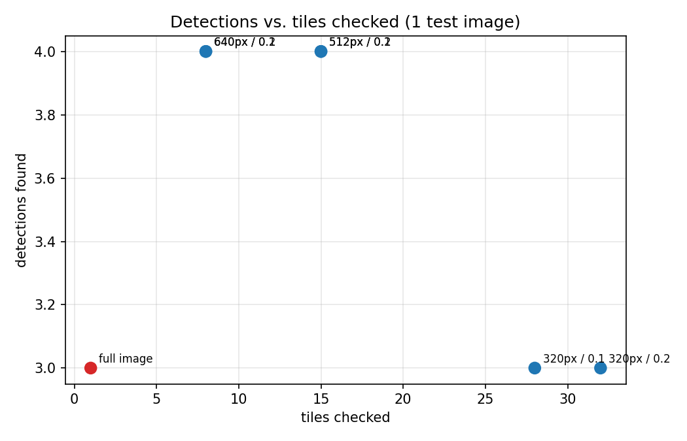
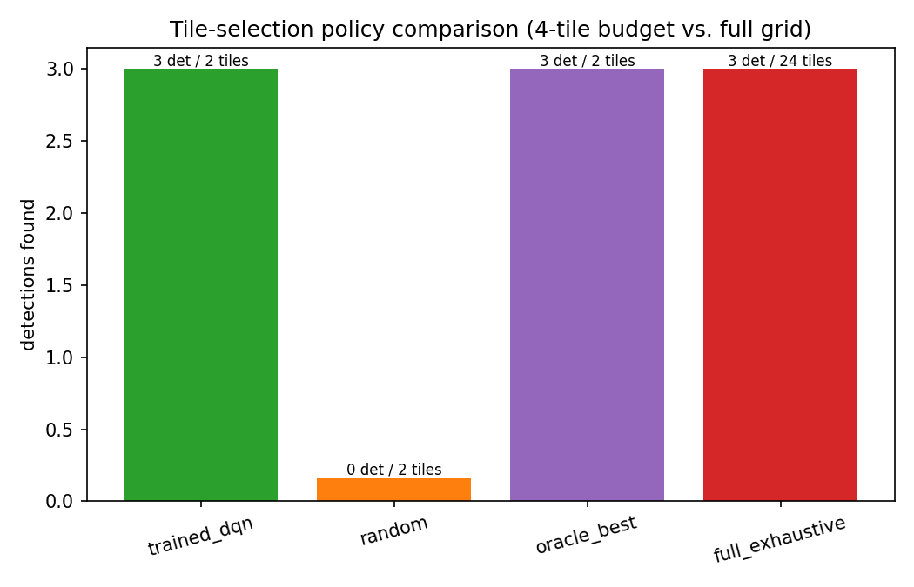
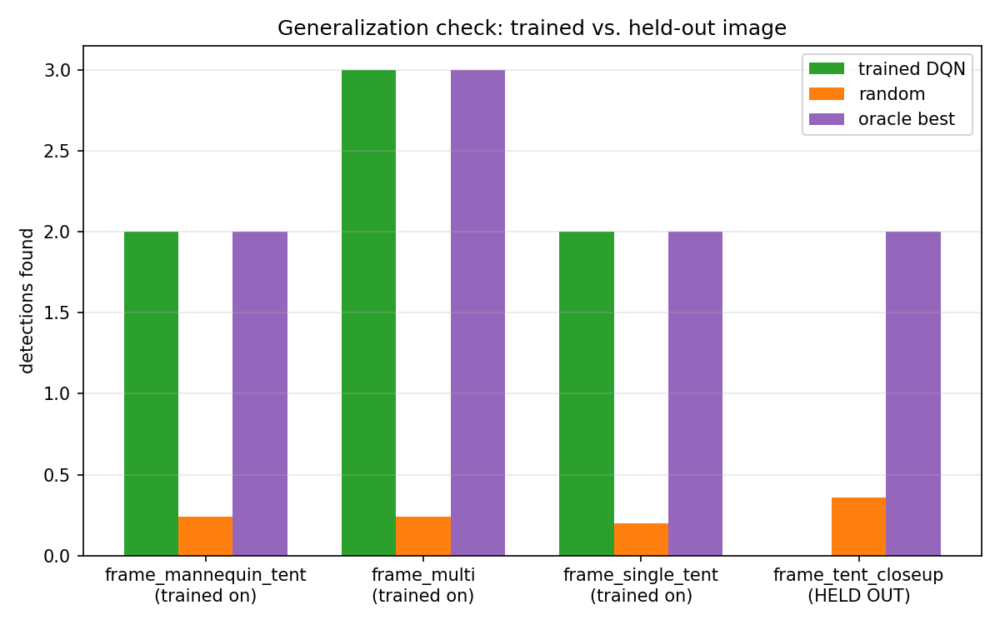
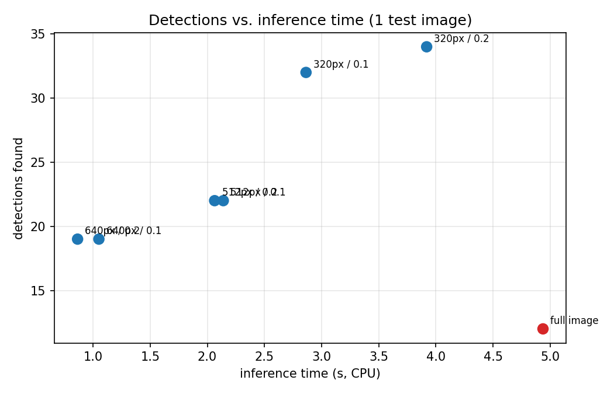
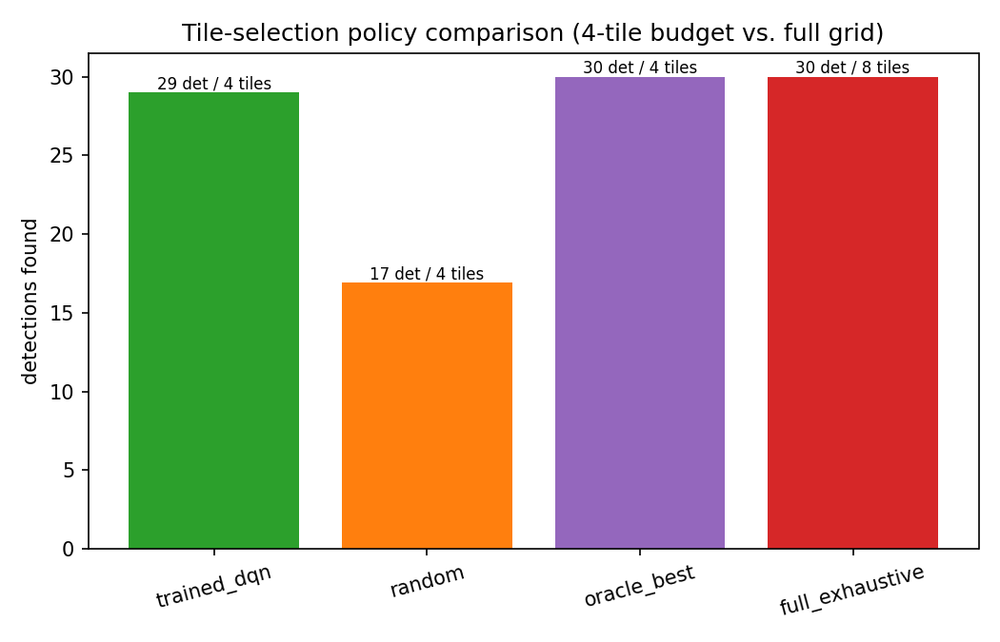
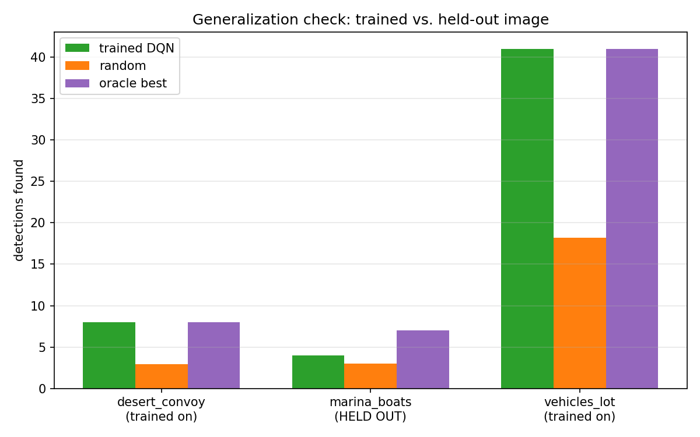

# Results

## Real mission data (current)

Everything below this section used stand-in data (a stock parking lot photo,
generic pretrained COCO model) while we waited on real team data. We now
have both: Forge's own trained detector (`YOLO11n`, run `yolo11n5`, classes
`tent` and `mannequin`) and real flight footage (`flight_video.mp4`,
1920x1080, 30fps). This section redoes all three experiments on the real
thing. The placeholder-data sections further down are kept for history, not
because they're still the current result.

**Setup:** 4 clean frames pulled from one real test flight (no pre-existing
detection overlay), each with real tents/mannequins at real altitude.
Confidence threshold 0.25, CPU only.

### Real baseline: does tiling still help?

On `tent_mannequin_multi.jpg` (2 tents + 1 mannequin in frame):

| method | slice size | overlap | detections | tiles checked | time (s) |
|---|---|---|---|---|---|
| full image | - | - | 3 | 1 | 6.36 |
| sliced | 320 | 0.1 | 3 | 28 | 31.83 |
| sliced | 320 | 0.2 | 3 | 32 | 35.43 |
| sliced | 512 | 0.1 | 4 | 15 | 16.67 |
| sliced | 512 | 0.2 | 4 | 15 | 17.41 |
| sliced | 640 | 0.1 | 4 | 8 | 18.44 |

**This is a genuinely different finding than the placeholder result below,
and it's worth being upfront about it.** On the stock photo with a generic
COCO model, tiling nearly tripled detections (34 vs 12). On real data with
Forge's fine-tuned model, full-image inference already finds all 3 real
targets — tiling barely changes the count (the 4 vs 3 difference on coarser
tiles is a likely tile-seam duplicate, not a new find, matching the
duplicate-detection caveat already flagged below).



The likely reason: Forge's model was trained specifically to find these
targets at this altitude, so it doesn't need the "zoom in" trick that a
generic COCO model needed on tiny/unfamiliar objects. **This doesn't mean
tiling is useless** — it means the accuracy case for tiling is weaker once
the base model is actually fine-tuned for the task, and the real argument
for tiling (and for RL on top of it) is still the speed/compute one from
earlier: full image took 6.36s, the cheapest sliced config took 18.44s or
less depending on config, so tiling isn't obviously a win here on either
axis for this one frame. Needs more frames to say anything definitive — see
next steps.

### Real RL experiment: budgeted tile selection

Same setup as the single-image RL experiment below, but on the real frame
and real model, grid of 24 tiles (320px, no overlap, native 1920x1080
resolution — resizing down to a shared canvas was tried first and it
shrank the targets below what the model could detect, see the note in the
generalization section).

| policy | tiles checked | detections found |
|---|---|---|
| trained DQN agent | 2 | 3 |
| random tile picks (avg of 50 runs) | 2 | 0.2 |
| oracle best possible (2-tile budget) | 2 | 3 |
| full exhaustive tiling | 24 | 3 |



**This is the cleanest result in the whole project so far.** Only 2 of the
24 tiles actually contain anything (everything else is empty field), and the
trained agent learned to always pick exactly those 2 — perfect score,
checking 8% of the grid. Random guessing almost never finds them (0.2 out of
3 on average) because the reward is so sparse. This is a much starker
demonstration of the RL idea than the placeholder version: on real data, the
"find the needle" problem is real, and the agent solves it.

### Real generalization test: train on 3 real frames, test on 1 unseen

| image | status | trained agent | random (avg) | oracle best | full exhaustive |
|---|---|---|---|---|---|
| frame_mannequin_tent | trained on | 2 | 0.2 | 2 | 2 |
| frame_multi | trained on | 3 | 0.2 | 3 | 3 |
| frame_single_tent | trained on | 2 | 0.2 | 2 | 2 |
| frame_tent_closeup | **held out, never seen** | **0** | 0.4 | 2 | 2 |



**Honest result: it didn't generalize at all here, and that's informative,
not just disappointing.** Perfect on all 3 seen frames, same as the
single-image result. On the held-out frame it got 0 — actually worse than
random (0.4). Here's why, and it's a real, useful finding: the real targets
are tiny relative to a 320px tile (a few dozen pixels in a 100,000+ pixel
tile), so the handcrafted features we're using (average tile color, edge
density) barely move when a target is present vs. absent at this scale —
there's effectively no usable signal in those features for this problem.
The agent trained on 3 frames most likely just memorized "tile 11 is
usually good" (true for 2 of the 3 training frames) rather than learning a
real visual rule, and had nothing to fall back on when the target moved to
a new tile in the held-out frame.

This sharpens next-step #7 (CNN features instead of handcrafted ones) from
a nice-to-have into a hard requirement for this problem specifically —
average color/edge stats are too coarse to represent a target this small
relative to its tile. A learned embedding that can actually represent "is
there a small dark/blue blob here" is very likely necessary, not optional.

### What to tell the team tonight, honestly

- The real model and real flight data both exist and both work — that's
  confirmed, not assumed
- The RL mechanism works great in the "find 2 needles in 24 haystacks"
  setting real data actually looks like (perfect score, 8% of tiles)
- It does not yet generalize to an unseen frame, and we know specifically
  why (features too coarse for target size), not just "it needs more data"
- The tiling-helps-accuracy story is weaker on real data than it looked on
  the placeholder data, because the real model is already good; the
  stronger pitch is still the speed/compute one

### Real-data experiments still to run

1. **More real frames, more variety.** All 4 frames here are from one short
   flight pass over one field. Need frames from different flights/fields/
   lighting for both a fair baseline comparison and a real generalization
   test.
2. **CNN tile features instead of handcrafted color/edge stats** — this is
   now a confirmed requirement, not a guess, given the 0/2 held-out result.
3. **NMS merging across tile boundaries**, now with real duplicate evidence
   (the 512px/640px configs found 4 vs. full image's 3 — likely one
   duplicate, not a new target).
4. **Real ground truth labels for these frames** (not just the model's own
   detections) to measure actual recall, not just "detections per the same
   model we're testing" — right now the oracle and the thing being judged
   are the same model, which is useful for proving the RL mechanism but not
   for measuring real-world accuracy.

### Reproduce (real data)

Needs `models/forge_yolo11n_v19_best.pt` (Forge's trained model, included in
this repo) and `data/real/*.jpg` (4 clean frames pulled from Forge's own
`flight_video.mp4`, included in this repo).

```bash
source .venv/bin/activate

# baseline
python src/tiled_inference.py --image data/real/tent_mannequin_multi.jpg \
    --model models/forge_yolo11n_v19_best.pt --out results/baseline_real.csv --save-vis
python src/make_plots.py --csv results/baseline_real.csv --out results/plots_real

# single-image RL
python src/build_oracle.py --image data/real/tent_mannequin_multi.jpg --tile-size 320 \
    --model models/forge_yolo11n_v19_best.pt --out results/tile_oracle_real.csv
python src/train_rl.py --oracle results/tile_oracle_real.csv --budget 2 --episodes 800 \
    --out results/rl_training_real.csv
python src/plot_rl.py --training results/rl_training_real.csv \
    --summary results/rl_training_real_summary.csv --out results/plots_real

# generalization (train on 3 real frames, test on 1 held out)
python src/build_oracle_multi.py --dataset real --model models/forge_yolo11n_v19_best.pt \
    --out results/tile_oracle_multi_real.csv
python src/train_rl_generalization.py --oracle results/tile_oracle_multi_real.csv \
    --held-out frame_tent_closeup --budget 3 --episodes 800 \
    --out results/rl_generalization_summary_real.csv
python src/plot_generalization.py --summary results/rl_generalization_summary_real.csv \
    --out-name rl_generalization_real.png
```

---

# Placeholder-data results (superseded, kept for history)

This is the baseline the RL stretch goal will eventually have to beat. There's
no RL here yet — this is just establishing "how much does checking every
tile help, and what does it cost." See the one-pager for the full plan and
why RL comes after this.

**Setup:** one stand-in aerial photo (SAHI's tutorial image — real flight
footage swap is still pending team dataset access, see `README.md`),
pretrained YOLOv8n, confidence threshold 0.25, CPU only (no local GPU).

## Results

| method | slice size | overlap | detections | tiles checked | time (s) |
|---|---|---|---|---|---|
| full image | - | - | 12 | 1 | 4.94 |
| sliced | 320 | 0.1 | 32 | 8 | 2.86 |
| sliced | 320 | 0.2 | 34 | 12 | 3.92 |
| sliced | 512 | 0.1 | 22 | 6 | 2.14 |
| sliced | 512 | 0.2 | 22 | 6 | 2.06 |
| sliced | 640 | 0.1 | 19 | 2 | 1.05 |
| sliced | 640 | 0.2 | 19 | 2 | 0.87 |





## What this says

- Full-image inference is genuinely bad at this: it misses most of the small
  stuff. 12 detections vs 34 for the finest tiling is a 3x gap.
- Finer tiling (320px) finds way more AND is faster than full image, because
  each tile is a smaller image for YOLO to run on. Full image isn't even the
  cheap option here.
- Coarser tiling (640px) is nearly free (2 tiles, under a second) but barely
  beats full image on detections. There's a real knee in the curve between
  512px and 320px.
- The overlap setting matters less than slice size at this scale (0.1 vs 0.2
  overlap only moves detections by 1-2 either way, except at 320px where it's
  a bigger swing: 32 vs 34).

This is the gap an RL search policy is supposed to close: get close to the
34-detection number of the finest tiling, but by picking ~4-5 good tiles
instead of checking all 12. Right now we don't have that number because
there's no RL agent built yet — this table is purely "check nothing extra"
vs "check everything."

## Caveats (why this isn't report-ready yet)

- **One image, no ground truth.** "Detections" is just raw count, not
  verified recall against labeled objects. A false positive counts the same
  as a real catch. We spotted at least one tile-seam false positive already
  (a low-confidence "airplane" on the finest tiling).
- **Stand-in image, not real flight footage.** Pending team dataset access
  or a VisDrone/DOTA fallback.
- **Pretrained COCO model, not tuned for this task's object classes.**
- **No duplicate handling.** Overlapping tiles can detect the same object
  twice; nothing here merges those with NMS yet, so detection counts may be
  somewhat inflated for the overlapping configs.

## First RL experiment: budgeted tile selection

This is the first actual RL code, not just baseline tiling. Setup: split the
same test image into a fixed 8-tile grid (no overlap, 320px tiles), give the
agent a budget of 4 tiles (half the grid), and train a small DQN to pick
which 4 tiles to check to find the most detections. Reward per tile comes
from a precomputed oracle (ran the detector on every tile once up front, see
`build_oracle.py`) so training doesn't need to re-run YOLO every step.

| policy | tiles checked | detections found |
|---|---|---|
| trained DQN agent | 4 | 29 |
| random tile picks (avg of 50 runs) | 4 | 16.9 |
| oracle best possible (4-tile budget) | 4 | 30 |
| full exhaustive tiling | 8 | 30 |




**What this shows:** with half the tile budget, the trained agent gets 29 of
30 possible detections, basically matching the oracle-best policy and far
beating random picking (16.9). Checking all 8 tiles only gets 1 more
detection (30) than the agent gets with half the tiles.

**What this does NOT show yet, and why:** this is one image, so the agent is
memorizing "tiles 1, 2, 5, 6 are the good ones for this specific photo," not
learning a transferable rule like "look where there's road/parking texture."
The state the agent sees is just a visited-tile mask, no actual image
content, so there's nothing for it to generalize from. This proves the RL
loop (env, reward, replay buffer, DQN training, target network) actually
works end to end. It's not evidence yet that the agent can do this on a tile
grid it hasn't seen. That needs real image features in the state and
training across many images -- see next steps below.

## Second RL experiment: does it generalize to an unseen image?

The first RL experiment only used one image, so there was no way to tell if
the agent learned anything real or just memorized tile positions for that
one photo. This experiment fixes both gaps it called out: tiles now carry
real visual features (average color + an edge-density score, not just a
visited/not-visited flag), and there are three different real images --
a parking lot (`vehicles_lot`), a desert jeep convoy (`desert_convoy`), and
an aerial marina full of boats (`marina_boats`). All three get resized to
the same canvas and cut into the same 12-tile grid so tile 0..11 means the
same position across images.

The agent trained only on `vehicles_lot` and `desert_convoy`. `marina_boats`
was never shown during training -- held out specifically to test whether the
agent learned a transferable rule ("tiles that look like X usually have
targets") instead of memorizing specific photos. Budget: 5 of 12 tiles.

| image | status | trained agent | random (avg) | oracle best | full exhaustive |
|---|---|---|---|---|---|
| vehicles_lot | trained on | 41 | 18.2 | 41 | 42 |
| desert_convoy | trained on | 8 | 3.0 | 8 | 8 |
| marina_boats | **held out, never seen** | **4** | 3.0 | 7 | 7 |



**What this shows:** on the two images it trained on, the agent matches the
oracle best almost exactly, same as before. On the held-out marina image it
has genuinely never seen, it still beats random guessing (4 vs 3.0) but
falls short of the oracle best (4 vs 7). That's a real, if modest,
generalization result: the visual features gave it something to go on, not
nothing, but it is not yet transferring as well as it performs on images
it was trained on. That gap (4 vs 7 on the unseen image, vs. 41/41 and 8/8
on seen ones) is the honest headline number here, and the next experiments
below are aimed straight at closing it.

**Why the gap is believable, not a bug:** three training/eval images with
handcrafted color/edge features is a small, simple signal. The marina image
is also the most visually different of the three (dark water instead of
dirt/pavement, boats instead of cars), so it's the hardest possible
held-out case, not a cherry-picked easy one.

## Experiments still to run

1. **Swap in real images** (team dataset or VisDrone/DOTA) — the current
   numbers could shift once it's not one cherry-picked tutorial photo.
2. **Get ground truth and measure actual recall**, broken down by target
   pixel size, not just raw detection counts. This is the only way to know
   if tiling is finding real objects or junk.
3. **Add NMS merging across tile boundaries** and re-run, to see how much
   of the "more detections" story is duplicates vs. genuinely new finds.
4. **Sweep more slice sizes** between 320 and 512 to find where the real
   knee in the curve is, instead of jumping straight from 512 to 320.
5. **Run on multiple images** and average, so one unusual photo doesn't
   skew the conclusion either way.
6. **Train on more than 2 images.** Three images total (2 train, 1 held out)
   is enough to show a generalization gap exists, not enough to claim it's
   fixed. Needs a real dataset-sized pass (dozens of images minimum).
7. **Replace handcrafted color/edge features with a learned CNN embedding**
   per tile -- handcrafted features cap how subtle a pattern the agent can
   pick up on; a small trained feature extractor should close more of the
   seen-vs-held-out gap (41/41 & 8/8 vs. 4/7).
8. **Sweep the tile budget** (2, 4, 6+ tiles) to map out the
   detections-per-tile-checked curve for the RL policy the same way it's
   mapped for exhaustive tiling above, on both seen and held-out images.

## Reproduce

```bash
source .venv/bin/activate
python src/get_sample_image.py
python src/tiled_inference.py --image data/sample.jpg --out results/baseline.csv --save-vis
python src/make_plots.py

# RL tile-selection experiment (single image)
python src/build_oracle.py --image data/sample.jpg --tile-size 320 --out results/tile_oracle.csv
python src/train_rl.py --oracle results/tile_oracle.csv --budget 4 --episodes 300
python src/plot_rl.py

# RL generalization experiment (train on 2 images, test on a held-out 3rd)
python src/build_oracle_multi.py --out results/tile_oracle_multi.csv
python src/train_rl_generalization.py --oracle results/tile_oracle_multi.csv \
    --held-out marina_boats --budget 5 --episodes 500
python src/plot_generalization.py
```
