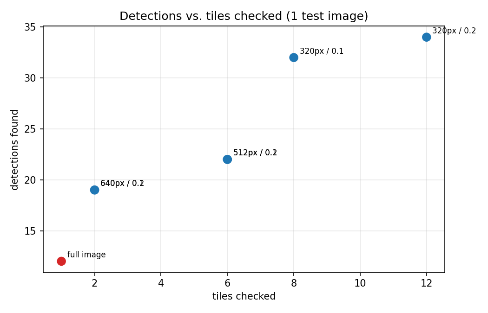
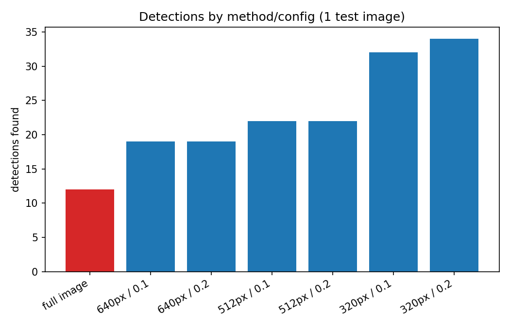
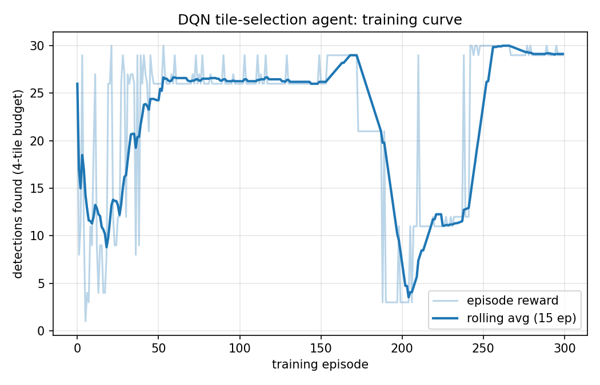

# Week 1 results: tiling vs. full-image baseline

This is the baseline the RL stretch goal will eventually have to beat. There's
no RL here yet — this is just establishing "how much does checking every
tile help, and what does it cost." See the one-pager for the full plan and
why RL comes after this.

**Setup:** one stand-in aerial photo (SAHI's tutorial image — real flight
footage swap is still pending team dataset access, see `README.md`),
pretrained YOLOv8n, confidence threshold 0.25, CPU only (no local GPU).

## Results

| method | slice size | overlap | detections | tiles checked | time (s) |
|---|---|---|---|---|---|
| full image | - | - | 12 | 1 | 4.94 |
| sliced | 320 | 0.1 | 32 | 8 | 2.86 |
| sliced | 320 | 0.2 | 34 | 12 | 3.92 |
| sliced | 512 | 0.1 | 22 | 6 | 2.14 |
| sliced | 512 | 0.2 | 22 | 6 | 2.06 |
| sliced | 640 | 0.1 | 19 | 2 | 1.05 |
| sliced | 640 | 0.2 | 19 | 2 | 0.87 |






## What this says

- Full-image inference is genuinely bad at this: it misses most of the small
  stuff. 12 detections vs 34 for the finest tiling is a 3x gap.
- Finer tiling (320px) finds way more AND is faster than full image, because
  each tile is a smaller image for YOLO to run on. Full image isn't even the
  cheap option here.
- Coarser tiling (640px) is nearly free (2 tiles, under a second) but barely
  beats full image on detections. There's a real knee in the curve between
  512px and 320px.
- The overlap setting matters less than slice size at this scale (0.1 vs 0.2
  overlap only moves detections by 1-2 either way, except at 320px where it's
  a bigger swing: 32 vs 34).

This is the gap an RL search policy is supposed to close: get close to the
34-detection number of the finest tiling, but by picking ~4-5 good tiles
instead of checking all 12. Right now we don't have that number because
there's no RL agent built yet — this table is purely "check nothing extra"
vs "check everything."

## Caveats (why this isn't report-ready yet)

- **One image, no ground truth.** "Detections" is just raw count, not
  verified recall against labeled objects. A false positive counts the same
  as a real catch. We spotted at least one tile-seam false positive already
  (a low-confidence "airplane" on the finest tiling).
- **Stand-in image, not real flight footage.** Pending team dataset access
  or a VisDrone/DOTA fallback.
- **Pretrained COCO model, not tuned for this task's object classes.**
- **No duplicate handling.** Overlapping tiles can detect the same object
  twice; nothing here merges those with NMS yet, so detection counts may be
  somewhat inflated for the overlapping configs.

## First RL experiment: budgeted tile selection

This is the first actual RL code, not just baseline tiling. Setup: split the
same test image into a fixed 8-tile grid (no overlap, 320px tiles), give the
agent a budget of 4 tiles (half the grid), and train a small DQN to pick
which 4 tiles to check to find the most detections. Reward per tile comes
from a precomputed oracle (ran the detector on every tile once up front, see
`build_oracle.py`) so training doesn't need to re-run YOLO every step.

| policy | tiles checked | detections found |
|---|---|---|
| trained DQN agent | 4 | 29 |
| random tile picks (avg of 50 runs) | 4 | 16.9 |
| oracle best possible (4-tile budget) | 4 | 30 |
| full exhaustive tiling | 8 | 30 |




**What this shows:** with half the tile budget, the trained agent gets 29 of
30 possible detections, basically matching the oracle-best policy and far
beating random picking (16.9). Checking all 8 tiles only gets 1 more
detection (30) than the agent gets with half the tiles.

**What this does NOT show yet, and why:** this is one image, so the agent is
memorizing "tiles 1, 2, 5, 6 are the good ones for this specific photo," not
learning a transferable rule like "look where there's road/parking texture."
The state the agent sees is just a visited-tile mask, no actual image
content, so there's nothing for it to generalize from. This proves the RL
loop (env, reward, replay buffer, DQN training, target network) actually
works end to end. It's not evidence yet that the agent can do this on a tile
grid it hasn't seen. That needs real image features in the state and
training across many images -- see next steps below.

## Experiments still to run

1. **Swap in real images** (team dataset or VisDrone/DOTA) — the current
   numbers could shift once it's not one cherry-picked tutorial photo.
2. **Get ground truth and measure actual recall**, broken down by target
   pixel size, not just raw detection counts. This is the only way to know
   if tiling is finding real objects or junk.
3. **Add NMS merging across tile boundaries** and re-run, to see how much
   of the "more detections" story is duplicates vs. genuinely new finds.
4. **Sweep more slice sizes** between 320 and 512 to find where the real
   knee in the curve is, instead of jumping straight from 512 to 320.
5. **Run on multiple images** and average, so one unusual photo doesn't
   skew the conclusion either way.
6. **Give the RL agent real image features**, not just a visited-tile mask,
   so it has something to learn a general rule from (e.g. a small CNN
   embedding of each tile, or coarse downsampled image patches per tile).
7. **Train across multiple images** once 6 is done, and test on held-out
   images the agent never saw, to check whether the policy actually
   generalizes or just memorizes per-image tile rankings.
8. **Sweep the tile budget** (2, 4, 6 tiles out of 8+) to map out the
   detections-per-tile-checked curve for the RL policy the same way it's
   mapped for exhaustive tiling above.

## Reproduce

```bash
source .venv/bin/activate
python src/get_sample_image.py
python src/tiled_inference.py --image data/sample.jpg --out results/baseline.csv --save-vis
python src/make_plots.py

# RL tile-selection experiment
python src/build_oracle.py --image data/sample.jpg --tile-size 320 --out results/tile_oracle.csv
python src/train_rl.py --oracle results/tile_oracle.csv --budget 4 --episodes 300
python src/plot_rl.py
```
